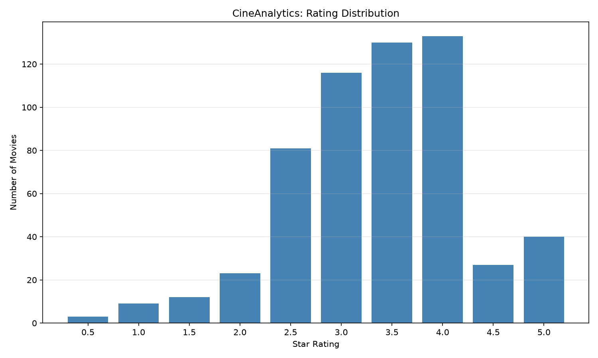
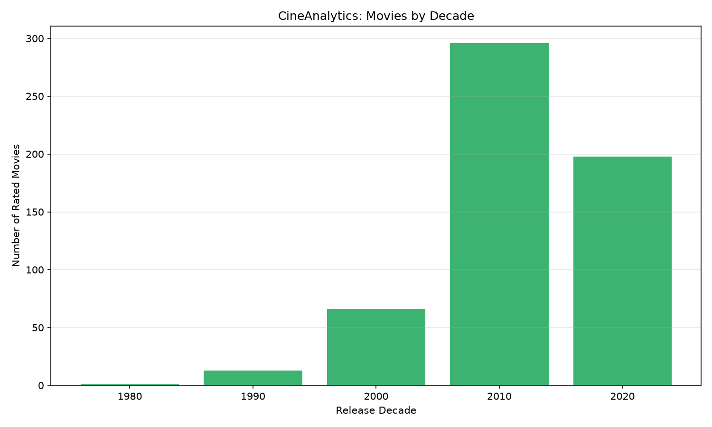
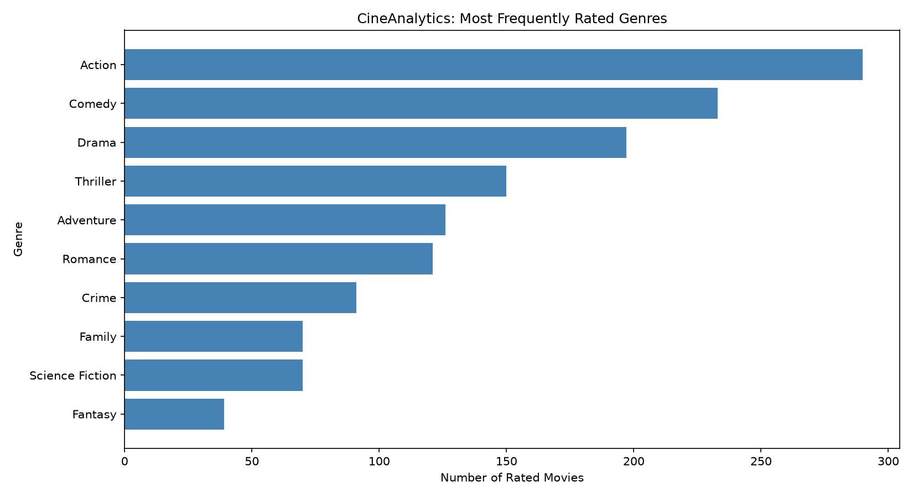
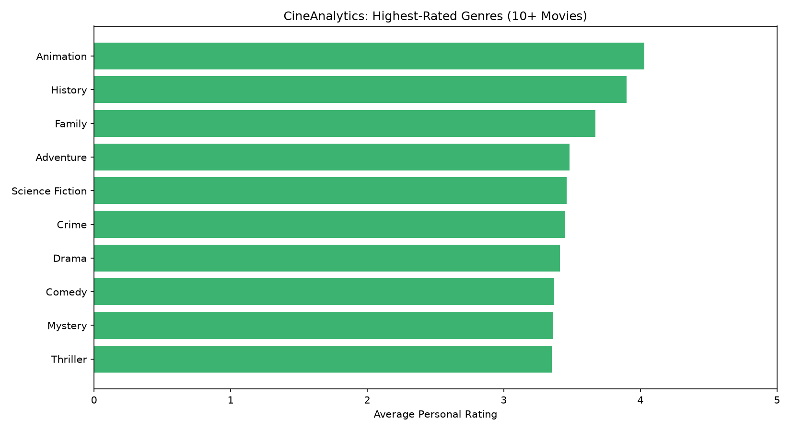

# CineAnalytics

### Personal Movie Ratings & Data Analytics

CineAnalytics is a Python-based data analytics project that explores personal movie ratings exported from Letterboxd. It uses data cleaning, statistical analysis, SQL queries, API integration, and visualizations to identify trends in movie preferences.

## Project Overview

The project analyzes a dataset of 574 personally rated movies and enriches the data with genre information retrieved through The Movie Database (TMDB) API.

It produces automated visualizations, CSV reports, and a Markdown analysis report.

## Technologies Used

- **Python** — Core programming language
- **Pandas** — Data cleaning, manipulation, and aggregation
- **SQLite** — Database storage and SQL queries
- **Matplotlib** — Data visualization
- **Requests** — TMDB API integration
- **python-dotenv** — Environment variable management

## Features

- Data cleaning and duplicate handling
- Movie rating distributions and statistical summaries
- Movie release decade comparisons
- Movie genre analysis using TMDB metadata
- Monthly rating activity analysis
- SQL-based data aggregation
- Automated chart generation
- Automated Markdown report generation
- Local caching of movie metadata
- One-command data analysis pipeline

## Dataset

The project uses personal Letterboxd ratings containing movie titles, release years, ratings, and rating dates.

Genre information is retrieved from the TMDB API.

**Dataset size:** 574 movies

**Successfully matched to TMDB:** 550 movies (95.8%)

The personal ratings dataset and API credentials are excluded from the public repository.

## Key Findings

- The average movie rating was **3.37/5**.
- The most frequently awarded rating was **4 stars**.
- Movies released in the **2010s** represented the largest portion of the dataset.
- **Action** was the most frequently rated genre, appearing in 290 matched movies.
- **Animation** had the highest average rating among genres containing at least 10 movies, at **4.03/5**.

These findings reflect the analyzed dataset and may change when new ratings are added.

## Data Visualizations

### Rating Distribution

### Movies by Release Decade

### Genre Distribution

### Average Ratings by Genre

## How to Run

### 1. Clone the repository

Clone the project from GitHub and open its folder in VS Code.

### 2. Install dependencies

Create and activate a Python virtual environment.

Install the required packages:

`python -m pip install -r requirements.txt`

### 3. Add the dataset

Export ratings from Letterboxd and place `ratings.csv` inside the `data` folder.

### 4. Configure TMDB

Create a `.env` file in the project directory.

Add:

`TMDB_TOKEN=your_api_read_access_token`

### 5. Run the analysis

Execute:

`python update.py`

The program will run all three analysis scripts automatically.

### 6. View results

Open the `output` folder to view generated charts and CSV reports.

Open `output/cineanalytics_report.md` to view the complete analytics report.

## Project Structure

- `main.py` — Rating and decade analysis
- `genre_analysis.py` — TMDB genre analysis
- `report_generator.py` — Automated report generation
- `update.py` — Runs the complete analysis pipeline
- `data/` — Local dataset and metadata cache
- `output/` — Generated charts and reports

## Limitations

- The dataset represents one user's movie ratings.
- Some movies could not be confidently matched to TMDB.
- Movies can belong to multiple genres.
- Smaller genre categories may produce less representative averages.
- Rating dates do not necessarily represent movie watch dates.
- Automated metadata matching may occasionally produce incorrect results.

## Data Sources and Attribution

Movie rating data was exported from Letterboxd.

Movie metadata is provided by The Movie Database (TMDB).

This product uses the TMDB API but is not endorsed or certified by TMDB.

Letterboxd: https://letterboxd.com/

TMDB: https://www.themoviedb.org/

## Future Improvements

- Improved matching for ambiguous movie titles
- More detailed genre and decade comparisons
- Interactive data visualizations
- Additional SQL analysis

---

**CineAnalytics — A personal project exploring data analytics through movies.**
