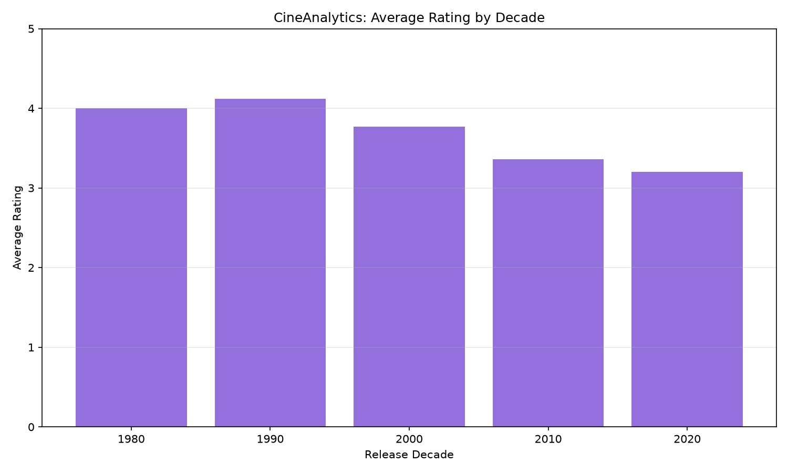
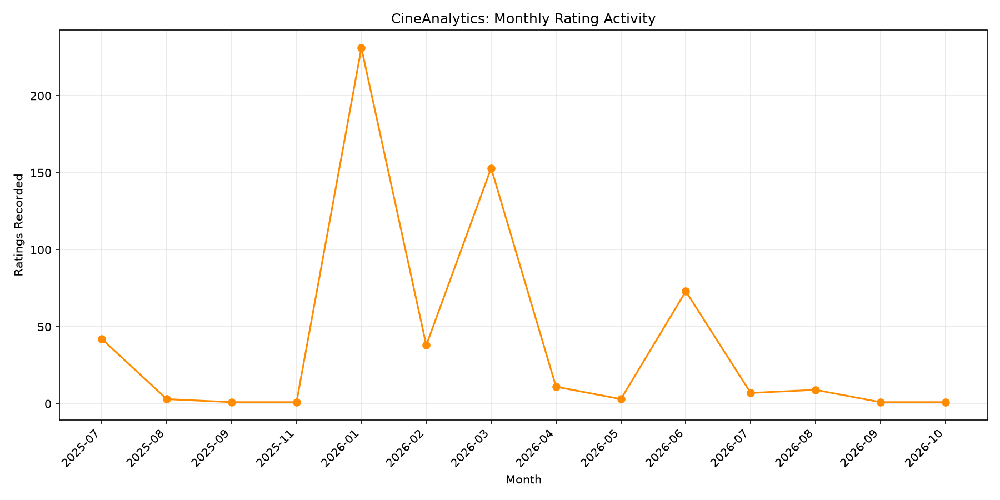

# CineAnalytics
## Personal Movie Ratings & Data Analysis Report

**Generated:** October 08, 2026

**Tools:** Python, Pandas, SQLite, Matplotlib, TMDB API

---

## 1. Executive Summary

CineAnalytics is a data analytics project that explores
personal movie ratings exported from Letterboxd.

The analysis examines rating distributions, release
decades, genre preferences, and rating activity.

The dataset contains **574 rated movies**,
with an overall average rating of **3.37/5**.

Genre information was retrieved from TMDB for
**550 movies**, representing
**95.8%** of the rated collection.

---

## 2. Overall Rating Statistics

| Metric | Value |
|---|---:|
| Movies Rated | 574 |
| Average Rating | 3.37/5 |
| Median Rating | 3.5/5 |
| Five-Star Movies | 40 |
| Most Common Rating | 4.0/5 |
| Movies Rated 4+ Stars | 200 |
| Percentage Rated 4+ Stars | 34.8% |

### Rating Distribution

| Star Rating | Movies |
|---|---:|
| 0.5 | 3 |
| 1.0 | 9 |
| 1.5 | 12 |
| 2.0 | 23 |
| 2.5 | 81 |
| 3.0 | 116 |
| 3.5 | 130 |
| 4.0 | 133 |
| 4.5 | 27 |
| 5.0 | 40 |

---

## 3. Release Decade Analysis

The most represented decade is the
**2010s**, with
**296 rated movies**.

| Release Decade | Movies | Average Rating |
|---|---:|---:|
| 1980s | 1 | 4.00 |
| 1990s | 13 | 4.12 |
| 2000s | 66 | 3.77 |
| 2010s | 296 | 3.36 |
| 2020s | 198 | 3.20 |

---

## 4. Genre Analysis

TMDB metadata was matched to
**550 of 574 movies**.

**Most frequently rated genre:**
Action

**Highest-rated qualifying genre:**
Animation
(4.03/5)

Only genres containing at least 10 movies
were considered when identifying the
highest-rated genre.

### Genre Statistics

| Genre | Rated Movies | Average Rating |
|---|---:|---:|
| Action | 290 | 3.28 |
| Comedy | 233 | 3.37 |
| Drama | 197 | 3.41 |
| Thriller | 150 | 3.35 |
| Adventure | 126 | 3.48 |
| Romance | 121 | 3.23 |
| Crime | 91 | 3.45 |
| Family | 70 | 3.67 |
| Science Fiction | 70 | 3.46 |
| Fantasy | 39 | 3.15 |
| Animation | 33 | 4.03 |
| Horror | 25 | 2.90 |
| Mystery | 25 | 3.36 |
| History | 10 | 3.90 |
| War | 5 | 4.10 |
| Music | 3 | 3.83 |

---

## 5. Monthly Rating Activity

The month with the most recorded ratings was
**2026-01**, with **231 ratings**.

These values represent the dates ratings were
recorded on Letterboxd. They do not necessarily
represent when the movies were watched.

---

## 6. Key Findings

1. The dataset contains 574 movie ratings, with an overall average of 3.37/5.
2. The most frequently awarded rating is 4.0 stars.
3. 200 movies (34.8%) received ratings of at least 4 stars.
4. The 2010s is the most represented release decade, with 296 movies.
5. Action is the most frequently rated genre, appearing in 290 matched movies.
6. Animation has the highest average rating among genres with at least 10 movies, at 4.03/5.

---

## 7. Methodology

1. Exported movie ratings from Letterboxd.
2. Loaded and cleaned the data using Pandas.
3. Calculated rating statistics and release decade trends.
4. Retrieved additional movie metadata using the TMDB API.
5. Matched movies using title and release year.
6. Analyzed movie genres using Pandas and SQLite.
7. Generated visualizations using Matplotlib.
8. Combined the findings into this automated report.

---

## 8. Limitations

- The dataset represents one person's ratings,
  not the opinions of the wider movie audience.
- 24 movies could not be reliably
  matched to TMDB and were excluded from genre analysis.
- Genre statistics count movies in each applicable genre,
  so movies with multiple genres appear more than once.
- TMDB matches are automated and may contain occasional
  metadata errors.
- Some genres and decades have small sample sizes,
  making their average ratings less representative.
- Letterboxd rating dates are not necessarily watch dates.
- This is a descriptive analysis and does not establish
  causal relationships.

---

## 9. Conclusion

CineAnalytics demonstrates a basic end-to-end
data analytics workflow using Python, Pandas,
SQL, API integration, and data visualization.

The project highlights how personal rating data
can be processed, summarized, and presented
through reproducible analytical methods.

---

**Dataset:** Personal Letterboxd ratings export

**Movie metadata:** TMDB API

**Project:** CineAnalytics
